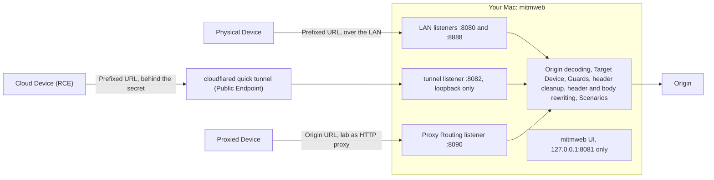

# roxy

A mitmproxy/mitmweb lab on your Mac for inspecting and manipulating the traffic of Roku apps, on Physical Devices and on Roku Cloud Emulator (Cloud Devices). The app calls Prefixed URLs (`<Proxy Base>/<Origin URL>`), so no device proxy setting or CA is needed. The same product's debug builds on phones, tablets and TV boxes (Proxied Devices) set the lab as their HTTP proxy instead (Proxy Routing).

Vocabulary: [GLOSSARY.md](GLOSSARY.md). Code conventions: [CODING_STANDARDS.md](CODING_STANDARDS.md). Changes: [CHANGELOG.md](CHANGELOG.md).

Issues are welcome on GitHub Issues; pull requests aren't accepted yet. To report a security problem, see [SECURITY.md](SECURITY.md). Licence: [MIT](LICENSE).

## Scope

- Every kind of Outbound Traffic: JSON APIs, images, HLS, DASH, Widevine licenses, RAF ads (VAST, VAST wrappers, VMAP) and their beacons.
- Inspection in mitmweb, and Manipulation: mocked or map-local responses, rewritten headers and bodies, injected faults (status, latency, drops), edited manifests, held-and-edited flows, and Recordings replayed or exported as HAR files.
- Proxied Devices: a Product App's debug builds on devices that are not Rokus (iOS, Android, Android TV and the like), through Proxy Routing; their store builds and apps that pin certificates are out of scope.
- Two disposable Lab Apps (classic BrightScript/SceneGraph and RSG 2.0) exercise every traffic class and serve as the regression grid. Store apps and Roku OS's own traffic are out of scope.

## How it works



The app puts the Proxy Base in front of every URL it builds, `<Proxy Base>/<Origin URL>` (or `<Proxy Base>/;<Origin URL>`, as a Charles-enabled build does): this is Prefix Routing, and it works on every Target Device. The lab recovers the Origin, applies its guards, rewrites URLs in responses so follow-up requests come back through it, then applies the active Scenarios. CA Routing, for Physical Devices only, uses DNS and the lab's CA instead; Proxy Routing, for Proxied Devices, the Proxied Device's HTTP proxy setting and the lab's CA, with no rewriting. The full picture: [How it works](docs/how-it-works.md).

## Quickstart

From a clone to a Scenario making an Origin fail on your Roku. Each step says what you should see; when one doesn't match, see [Troubleshooting](docs/troubleshooting.md).

### 1. Prerequisites

- macOS with [uv](https://docs.astral.sh/uv/) (installs the pinned mitmproxy 12.3.1 into `proxy/.venv`) and `brew install jq`.
- For steps 5 and 6, a Roku in developer mode on the same LAN as the Mac.

Cloud Devices, the RSG 2.0 Lab App and Docker Compose need more: [Cloud Devices](docs/cloud-devices.md), [Lab Apps](docs/lab-apps.md), [Docker Compose](docs/compose.md).

### 2. Install

```sh
git clone https://github.com/oscarsanchez/roxy.git && cd roxy
./install.sh
```

You should see `linked ~/.local/bin/roxy -> .../bin/roxy`, one `seeded <file>: fill it in` line per settings file, and `git hooks on: .githooks`. Put `~/.local/bin` on your PATH if it says so. `roxy` then works from any terminal, and `git pull` updates it. Run `./install.sh` again whenever you like: it never overwrites a setting.

### 3. Fill in your settings

Your settings live in the **settings root**, `~/.config/roxy/`, never in the repo. Fill in what the install seeded ([every field](docs/settings.md)):

- `secrets.env`: `MITMWEB_PASSWORD`, the mitmweb UI's password; `ROKU_DEV_USER` and `ROKU_DEV_PASSWORD`, your Roku's developer login.
- `settings.json`: `lan_subnets`, your LAN in CIDR, such as `["192.0.2.0/24"]`, which must hold the Mac and the Roku.
- `devices.json`: your Roku by name, `{"Living Room": {"ip": "<its IP>"}}`. This guide uses `Living Room`.

### 4. Start the lab and send one request

```sh
roxy start
```

You should see the mitmweb UI (`http://127.0.0.1:8081`), your `Proxy IP`, two `LAN Proxy Bases`, `http://<mac-ip>:8080` and `:8888`, and the `Proxy Routing` address for Proxied Devices, `<mac-ip>:8090`. A missing setting stops it before mitmweb starts, naming the setting. The lab runs in the foreground until Ctrl-C; every Lab Session is saved as a Recording ([Recordings](docs/recordings.md)).

From another terminal, send a Prefixed URL from the Mac itself, no Roku needed:

```sh
curl -i http://<mac-ip>:8080/https://httpbin.org/json   # HTTP/1.1 200 OK, and httpbin's JSON
roxy flows --json --limit 1                             # [{... "url": "https://httpbin.org/json", "status": 200, ...}]
```

The flow is in mitmweb too. `roxy --help` lists the subcommands, and `roxy <subcommand> --help` every option of one.

### 5. Launch the Lab App on your Roku

```sh
scripts/deploy "Living Room" apps/classic                # packages the classic Lab App and sideloads it
roxy console "Living Room" --launch json_get             # launches case json_get, waits for its result line
```

You should see `LABRESULT json_get run=<id> status=200 bytes=<n> fp=<hex>`, and in `roxy flows --json` the same request with `"device": "Living Room"`. Every case and result field: [Lab Apps](docs/lab-apps.md).

### 6. Make the Origin fail

```sh
roxy console "Living Room" --launch json_get --scenario json-503
roxy status --since <id>                                 # the run=<id> from the result line
roxy scenario clear
```

You should see `status=503` in the result line, and under `json-503` in `roxy status`: `httpbin json fails  1 flow`. A rule that acted on nothing says so (`acted on nothing yet`), so a Scenario never fails silently. `roxy scenario clear` leaves the lab with none active.

### Next

- [Scenarios](docs/scenarios.md): write your own, with mocks, throttles and manifest edits.
- [Prefix Routing guide](docs/prefix-routing.md): route a Product App, with its Charles hook or the kit.
- [Cloud Devices](docs/cloud-devices.md): the same on Roku Cloud Emulator.
- [Proxied Devices](docs/proxied-devices.md): your app's debug builds on phones, tablets and TV boxes through the same lab.
- [Agents](docs/agent-setup.md): let Claude Code or Cursor drive the lab.

## Documentation

Everything else, as how-tos, reference and explanation: [docs/README.md](docs/README.md).
